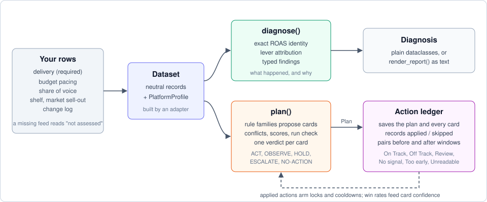

# cpm-lineage

`cpm_lineage` is a Python library that reads the delivery data of a CPM-billed ad account and
answers two questions: what happened to return on ad spend (ROAS) and why, and what should be done
about it. CPM billing means the advertiser pays per thousand impressions, as on quick-commerce
marketplaces, retail media networks and display exchanges. Most optimisation playbooks are written
for cost-per-click billing, where a wasted impression costs nothing. Under CPM every impression is
paid for, many platforms report no clicks at all, and the price of an impression moves with the
auction. The library is built around that: it factors ROAS exactly into conversion, selling price
and CPM, names the lever behind a move only when the evidence supports it, and turns the result
into a short list of reviewable actions. It is platform-agnostic: nothing about any one platform is
hard-coded, and a new platform is a profile plus an adapter.

Everything is a pure function over plain dataclasses. There is no network access and no database;
file I/O happens only in `adapters/` and `store/`. Dependencies: Python 3.10+ and numpy.

> **Status.** Version 0.1.0. The repository ships with synthetic data only. No result from a real
> account is in it, and nothing here is a claim about real-world performance. See
> [Limitations](#limitations).

## Quickstart (60 seconds)

```bash
git clone https://github.com/deepanshusharma-stack/cpm-lineage-public.git
cd cpm-lineage-public
pip install -e .
python examples/quickstart.py
```

The same thing from Python:

```python
from cpm_lineage import SyntheticAdapter, diagnose, plan, render_report

data = SyntheticAdapter().dataset     # 90 seeded days of one invented account, five planted events
diagnosis = diagnose(data)            # what happened, and why
action_plan = plan(data)              # what to do about it
print(render_report(diagnosis, action_plan))
```

The report has five blocks: `DIAGNOSIS` (the identity table), `FINDINGS`, `ENTITIES`, `MARKET` and
`PLAN`. These lines of it are the five planted events, found, and the three cards the plan ships:

```text
FINDINGS (5)
  [cpm_rise] CPM on 'protein bar' rose 62% (149 -> 242): rival pressure
  [availability_drop] availability of sku-a2 in geo-south fell 0.95 -> 0.58
  [budget_bound_winner] cmp-winner is budget-bound at ROAS 6.30: top up daily budget (range 8,255-12,700 per day)
  [bleeding_keyword] 'rivalb bar' (competitor) returns ROAS 0.34 on 142,904 spend: cut
  [own_collision] 2 own campaigns bid 'energy bar' in 4 auction(s); keep it on cmp-generic, 130,292 sits on the weaker one(s)
  holdout (untouched this period): cmp-brand, cmp-conquest, cmp-reach
  w3 ACT       pending   conf 79  Increase Budget +25%  [cmp-winner]
  w2 ACT       pending   conf 73  Hold Bid Under Pressure  [cmp-generic: protein bar]
  w1 ACT       pending   conf 73  Resolve Keyword Collision  [cmp-overlap: energy bar]
```

Two things surprise first-time readers of the `PLAN` block:

* **Holdout.** `plan()` leaves a stable 15% of eligible entities untouched each month as a standing
  comparison group. An entity is a budget-holding unit: a campaign, ad group or line item. A
  problem on a held-out entity gets no card, which is why the bleeding keyword on `cmp-conquest`
  is a finding above but not a card. Pass `pipeline_cfg=PipelineConfig(holdout_pct=0)` to switch
  the holdout off, or `holdout=[...]` to name the group yourself.
* **ROAS basis.** Entity ROAS in both calls counts `EngineConfig.indirect_sales_weight` of
  `PerfRow.indirect_sales` (halo or view-through sales): `1.0` by default, `0` for direct sales
  only. The identity table always reads direct sales and says so.

## How the pieces fit



1. **Rows.** An adapter turns your export into neutral records (`PerfRow` and the optional feeds)
   and a `PlatformProfile` that declares what the platform means.
2. **`diagnose()`** decomposes the ROAS move, attributes it to levers and returns typed findings.
3. **`plan()`** lets rule families propose action cards, resolves their conflicts, scores them,
   applies your run check (a ROAS floor or a spend ceiling) and gives every card one verdict:
   `ACT`, `OBSERVE`, `HOLD`, `ESCALATE` or `NO-ACTION`.
4. **The ledger** saves the plan, records which cards a person applied or skipped, and later
   labels each applied card by comparing the windows before and after it.

The library never changes anything on a platform. It reads records and returns dataclasses.

### The identity underneath

On a CPM platform the impression count cancels, so ROAS factors exactly into three channels:
`ROAS = 1000 x ICR x ASP / CPM`, where `ICR = units / impressions` (impression conversion rate),
`ASP = sales / units` (average selling price) and `CPM = 1000 x spend / impressions`. In logs,
`d ln ROAS = d ln ICR + d ln ASP - d ln CPM`. ICR stands in for the click funnel because many CPM
platforms report no clicks; where clicks exist, `ICR = CTR x CVR` and nothing else changes. This
step involves no model, and the three terms add up to the move:

```python
layer1 = diagnosis.entities["cmp-generic"].layer1
parts = {name: channel.log_points for name, channel in layer1.channels.items()}
assert abs(sum(parts.values()) - layer1.raw_dln) < 1e-9 and layer1.exact
print({name: round(value, 4) for name, value in parts.items()}, "sum", round(layer1.raw_dln, 4))
```

```text
{'icr1k': 0.0231, 'asp': -0.0062, 'cpm': -0.2356} sum -0.2188
```

### Closing the loop with the ledger

```python
from dataclasses import replace
from datetime import timedelta

from cpm_lineage.outcomes import pair_outcomes
from cpm_lineage.store import ActionLedger

cut = data.latest_date - timedelta(days=14)            # pretend today is two weeks before the data ends
early = replace(data, perf=[r for r in data.perf if r.date <= cut],
                budget_days=[r for r in data.budget_days if r.date <= cut])

ledger = ActionLedger()                                # in memory; ActionLedger(SQLiteBackend(path)) persists
name = data.profile.name
p = plan(early, ledger=ledger, account="demo")         # saves the plan and one ledger row per card and horizon
card = p.actionable[0]
ledger.mark("demo", name, p.id, card.id, "applied", today=cut + timedelta(days=1))   # a person's decision

result = pair_outcomes(ledger, "demo", name, data.perf,     # run daily; a row is paired once, then fixed
                       today=cut + timedelta(days=8), offtake=data.offtake)
print(card.title, card.entity_id, "->", result.outcomes)
```

```text
Increase Budget cmp-winner -> {'On Track': 1}
```

The synthetic data does not react when a card is marked applied, so this label describes the
entity's untreated trajectory. It shows the mechanics, not that the action worked.

## What it answers

* **Which of conversion, selling price or CPM moved ROAS?** The exact identity, at account, entity
  or any finer grain (`identity`, `decompose`).
* **Which lever is behind the move?** A lever attribution that ends in one of four verdicts:
  `confirmed`, `directional`, `unexplained` or `thin-data` (`attribution`).
* **Why did the CPM of a keyword rise?** A better position you bought, a rival gaining share of
  voice, a worse spot, or the auction price (`cpm`).
* **Is a profitable entity held back by its daily budget, and what raise is defensible?**
  Budget-bound tests, a saturation curve and raise sizing (`budget`).
* **Which keywords lose money, and which are missing?** Cut and add recommendations by keyword
  role: own brand, sibling brand, competitor, generic (`keywords`).
* **Are two of your own campaigns bidding against each other?** Collision detection
  (`actions.families`).
* **Where did availability fall, and what did it cost?** A geo and product drilldown (`geo`).
* **Why did sales or market share move?** A market root-cause read, when a market sell-out feed
  exists (`rca`, `market`).
* **What should be done, in what order, and what should be left alone?** A plan of scored cards,
  each with a verdict and a stated reason (`actions`, `verdict`).
* **Did an applied action do what its card predicted?** Outcome labels and realised win rates per
  rule family (`store`, `outcomes`).

When a feed that a question needs is missing, the answer is "not assessed", not a guess.

## Module map

| Module | What it holds |
|---|---|
| `schema`, `config`, `metrics`, `windows`, `liveness` | neutral record types, shared configuration, metric algebra, comparison windows, whether an entity can be acted on |
| `adapters` | `PlatformProfile`, `Dataset`, and the CSV, DataFrame and synthetic adapters |
| `identity`, `decompose` | the exact ROAS identity; shift-share, Pareto drag and composition decompositions |
| `attribution`, `recommend` | lever attribution (sign-constrained ridge model plus a first-difference cross-check); the per-entity recommendation |
| `budget`, `scorecard` | budget sufficiency, saturation curve, raise gating, budget moves, the three money estimators; a checkpoint scorecard |
| `cpm` | CPM views, the CPM-move classifier, the guardrail audit of a position-targeting bidder, auction and overpay checks |
| `keywords`, `market`, `geo`, `scoping`, `drill` | keyword roles and recommenders, share of voice and market reads, geo reads, scoping rules, drilldowns |
| `actions` | the rule families and the plan pipeline (resolve, score, run check, rebalance) |
| `verdict`, `conflicts` | the verdict pass over every card; resolvers for conflicting signals and conflicting sources |
| `store`, `outcomes` | the action ledger, history store and change log (memory or SQLite); outcome pairing |
| `coldstart`, `prescribe`, `screen`, `watchdog`, `queue` | cold-start pre-flight, one-row prescriptions, a correlation pre-screen, tripwire alerts, one ranked worklist |
| `rca` | root-cause analysis of a sales or share move between two windows |
| `engine` | `diagnose()`, `plan()` and `render_report()`: the orchestration over all of the above |

Also in the repository: `examples/` (four runnable scripts and a sample CSV export), `docs/`, and
`tools/` (`leak_scan.py`, a structural scanner for paths, keys and addresses that should not be
committed; `gen_thresholds.py`, which generates `docs/thresholds.md` from the source).

## Bring your own platform

A `PlatformProfile` declares a platform's semantics once: its ad types and what each can do, its
status vocabulary, what "position" means (or that there is none), the auction type, which
targeting types carry bids, and the money scale. Only the delivery fact (`PerfRow`: date, entity,
spend, impressions, and normally sales and units) is required. This is a complete second platform,
a second-price display network that bids on audiences and reports no position:

```python
from datetime import date, timedelta
from cpm_lineage import (AdTypeCapability, Dataset, PerfRow, PlatformProfile, PositionSemantics,
                         diagnose, render_report)

profile = PlatformProfile(                       # what the platform means, declared once
    name="my-display-network", auction_type="second_price", has_clicks=True,
    position=PositionSemantics(available=False),             # this platform reports no ad position
    ad_types={"display": AdTypeCapability(name="display", capability_class="keyword_auction")},
    status_map={"LIVE": "active", "STOPPED": "operator_paused"},
    biddable_targeting_types=frozenset({"audience"}),        # bids are placed on audiences
    currency_unit=0.01)                                      # campaigns spend tens a day, not thousands

end = date(2026, 6, 30)
rows = []                                        # stand-in for your export: 60 days, two line items
for ago in range(60):
    cost = 60.0 if ago < 30 else 40.0            # the "hikers" audience got 50% dearer 30 days ago
    for line_item, audience, spend, impressions, orders, revenue in (
            ("li-1", "hikers", cost, 5000, 4, 200.0), ("li-2", "campers", 30.0, 3000, 2, 90.0)):
        rows.append(PerfRow(date=end - timedelta(days=ago), entity_id=line_item, ad_type="display",
                            status="LIVE", targeting_unit=audience, targeting_type="audience",
                            spend=spend, impressions=impressions, units=orders, sales=revenue))
print(render_report(diagnose(Dataset(profile=profile, perf=rows))))
```

```text
  ROAS 4.14 -> 3.22 (-22.2%)  [direct sales]
    cpm         8.750 ->     11.250  log-points -0.251  share +100%
  [cpm_rise] CPM on 'hikers' rose 50% (8.00 -> 12.0): auction price
  note: no shelf feed: availability is not assessed
  note: no budget pacing feed: budget-bound tests and raise sizing are not assessed
```

The whole move is assigned to CPM because conversion and price did not change, and the two notes
show the library abstaining where a feed is absent. Words such as "keyword" and "campaign" in
finding kinds and card titles mean "targeting unit" and "entity".

Every other feed is optional:

| Feed | Record | Unlocks |
|---|---|---|
| delivery | `PerfRow` | identity, shift-share, keyword cut and leak scans, collisions, CPM views |
| budget pacing | `BudgetDayRow` | budget-bound tests, saturation curve, raise sizing |
| share of voice | `MarketRow` | rival pressure, organic share, keyword additions |
| shelf | `ShelfRow` | availability and price levers, the availability gate |
| market sell-out | `OfftakeRow` | market share, competition table, root-cause analysis |
| change log | `ChangeEvent` | regime guard, "was the change actually made" detection |

For file exports, `CsvAdapter` takes a column mapping (`examples/bring_your_own_data.py`). For a
nested API response with clicks, micros and country geos, see
`examples/custom_platform_adapter.py`. [docs/adapter_guide.md](docs/adapter_guide.md) covers the
contract field by field.

## Configuration

Every threshold is a named field on a frozen config dataclass, with its default and a one-line
rationale. Three values re-base most of the others:

```python
from cpm_lineage import Economics, EngineConfig

config = EngineConfig(economics=Economics(
    breakeven=1.2,        # ROAS at which a first purchase breaks even
    ltv_mult=1.0,         # lifetime value per first-purchase currency unit
    currency_unit=0.01,   # scale applied to every money threshold
))
rescaled = plan(data, config=config, rule_profile="verdict")
```

Profitability bars are multiples of the effective breakeven. Money thresholds are written in
reference units, for an account whose material campaigns spend thousands of currency units a day,
and are multiplied by `currency_unit`. No currency is baked in. `plan()` has three rule profiles:
`"classic"` (the default), `"marginal"` and `"verdict"`. [docs/thresholds.md](docs/thresholds.md)
lists every field.

## Design principles

* **Deterministic.** The same input gives the same output. The clock is the latest date in your
  data, the synthetic data is seeded, and the holdout draw is stable within a month. No function
  in the analysis path reads the wall clock or the network.
* **Every threshold is named.** No number that changes a decision is buried in a function body.
  Each one is a config field you can read in `docs/thresholds.md` and override per account.
* **Exact decompositions.** The identity and the shift-share add up to the move they explain, and
  a result is flagged `exact=False` when a zero channel had to be floored. Model-based steps are
  kept separate and labelled as such.
* **Abstain rather than guess.** A missing feed reads "not assessed". Attribution on too little
  data reads `thin-data`. A card that cannot be defended leaves with `HOLD`, `OBSERVE` or
  `NO-ACTION` and a reason, not silently.
* **No platform lock-in.** Platform semantics live in a `PlatformProfile`; rules read capabilities
  (does this ad type attribute sales, is there a position field, is the auction second-price) and
  never a platform name.

## What was measured

Every evaluation in this repository is on the library's own synthetic data. The one below is a
recovery check. The generator plants five events of known size (a 1.6 times CPM step on one keyword, an
availability drop for one product in one geo, a budget-capped profitable campaign, a competitor
keyword at ROAS about 0.35, and two own campaigns bidding one keyword). This block regenerates the
data under ten seeds and counts the runs in which `diagnose()`, on default settings, returns
exactly those five finding kinds and no other:

```python
planted = {"cpm_rise", "availability_drop", "budget_bound_winner", "bleeding_keyword", "own_collision"}
hits = sum({f.kind for f in diagnose(SyntheticAdapter(seed=seed).dataset).findings} == planted
           for seed in range(10))
print(f"{hits} of 10 seeds returned exactly the five planted finding kinds")
```

```text
10 of 10 seeds returned exactly the five planted finding kinds
```

This is a plumbing check. The generator and the defaults were written together, the planted events
are large, and the data contains no unplanted problems of the kinds the rules look for. It says
nothing about detection rates, false alarms or the right thresholds on a real account.
`python docs/guide/worked_example.py --eval 20` runs a stricter version that also checks each
finding lands on its planted target. The [paper](docs/paper/cpm-lineage-paper.pdf) reports wider
synthetic experiments (`python docs/paper/experiments.py`: 30 seeds, a world with nothing planted,
a dose-response sweep and a second platform), including where detection failed: a single-product
availability fall to 0.75 was missed in every run, and the `verdict` rule profile cut entities that
were not planted as problems.

## Limitations

* **Thresholds are judgment defaults.** None was fitted to or validated on real account data in
  this repository. Treat them as starting points and override them per account.
* **The three money estimators are not reconciled.** The stake (a rule of thumb), the fitted
  saturation curve and the finite-difference marginal ROAS answer slightly different questions and
  can disagree on the same raise. Every sized number carries an `estimator` label. Do not add or
  average across labels.
* **Attribution is observational, not causal.** A `confirmed` verdict means two models agree on
  the largest lever and day-to-day skill is non-negative. It is not an experiment.
* **The self-floor check assumes a second-price auction.** It flags a keyword where your own
  next-highest campaign may be setting the price you pay. It runs only when the profile declares
  `second_price` with bids quoted as CPM, and it has not been verified against billed prices.
* **The saturation curve is correlational.** It has no demand controls and no confidence interval,
  and it cannot be fitted for an entity that always spends exactly its cap.
* **Outcome labels are before-and-after reads adjusted for market movement.** They are not
  experiments. The holdout group is drawn and reported, but the library does not compute a
  holdout-versus-treated comparison.
* **Money thresholds assume one scale.** Set `currency_unit` if a material campaign does not spend
  thousands a day. `diagnose()` adds a note when the data sits far below the scale; `plan()` does
  not.
* **Vocabulary.** Finding kinds and card fields say "keyword" and "campaign" even on platforms
  that bid on audiences or categories.

## Documentation

| Document | For |
|---|---|
| [docs/how_it_works.md](docs/how_it_works.md) | one account followed through every step, with the numbers |
| [docs/guide/cpm-lineage-how-it-works.pdf](docs/guide/cpm-lineage-how-it-works.pdf) | the same guide as a PDF with figures |
| [docs/adapter_guide.md](docs/adapter_guide.md) | connecting a platform: profile, records, feeds |
| [docs/thresholds.md](docs/thresholds.md) | every config field, its default and its meaning (generated from the source) |
| [docs/rule_catalogue.md](docs/rule_catalogue.md) | the rules in platform-neutral terms |
| [docs/paper/cpm-lineage-paper.pdf](docs/paper/cpm-lineage-paper.pdf) | the paper: method, synthetic experiments, limits |

## Development

```bash
pip install -e ".[dev]"
python -m pytest
python tools/leak_scan.py
```

`python -m pytest` runs the suite, including a test that executes every code block in this file.
See [CONTRIBUTING.md](CONTRIBUTING.md) for how to propose a change and
[SECURITY.md](SECURITY.md) for how to report a vulnerability.

## Citation

If you use this library in published work, please cite it. `CITATION.cff` holds the same record.

```bibtex
@software{sharma_cpm_lineage,
  author  = {Sharma, Deepanshu},
  title   = {cpm-lineage: a platform-agnostic optimisation and diagnosis framework for CPM-billed ad platforms},
  version = {0.1.0},
  url     = {https://github.com/deepanshusharma-stack/cpm-lineage-public}
}
```

## Credits and license

Written by Deepanshu Sharma. MIT license; see [LICENSE](LICENSE).
