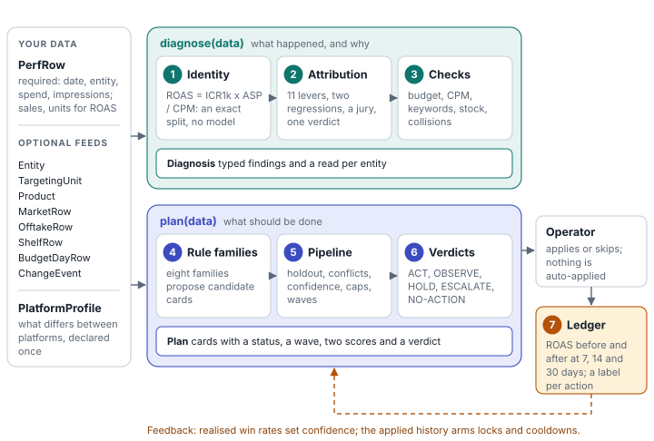
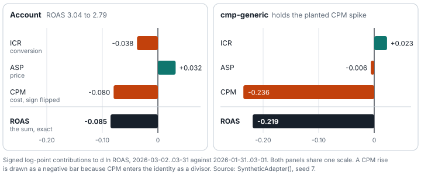
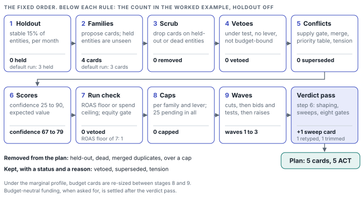
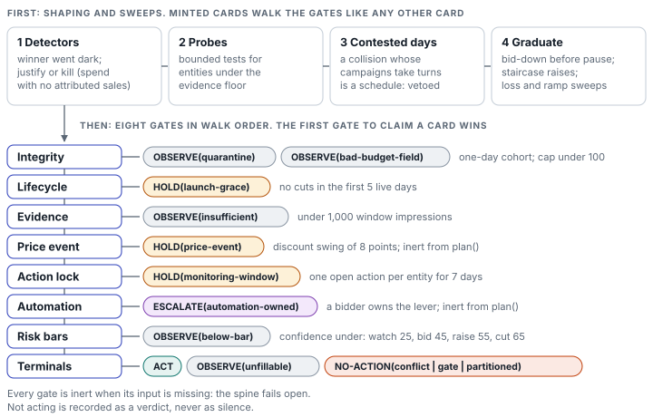
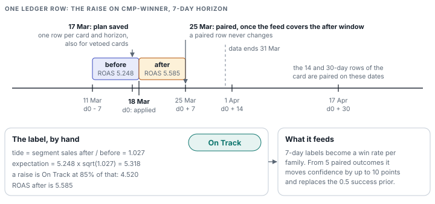

# How cpm-lineage works

A practitioner's guide to the `cpm_lineage` library, version 0.1.0. Written by Deepanshu Sharma.

This guide follows one account through the whole engine, from the rows you feed in to the scored
outcome of an action. It is for performance marketers who want to know what each number means and
for engineers who have to connect a platform and tune the thresholds.

**What the example is.** Every number below was produced by running the library on its own seeded
synthetic dataset (`SyntheticAdapter()`, seed 7, 90 days, five planted events). No data from a real
account is in this repository, so nothing here is a claim about real-world performance. The
synthetic run shows that the plumbing finds what was planted. It does not validate the thresholds
on your data.

**Reproduce it.**

```bash
pip install -e .
python examples/quickstart.py                    # the report quoted in this guide
python docs/guide/worked_example.py              # the per-step detail quoted in this guide
python docs/guide/worked_example.py --eval 20    # the recovery check in section 12
```

The committed output of the last two commands is `docs/guide/worked_example_output.txt`.

## Contents

1. [The flow in one picture](#1-the-flow-in-one-picture)
2. [The data you feed in](#2-the-data-you-feed-in)
3. [Step 1: the identity](#3-step-1-the-identity-tells-you-which-channel-moved)
4. [Step 2: attribution](#4-step-2-attribution-names-the-lever)
5. [Step 3: budget, keyword and CPM checks](#5-step-3-budget-keyword-and-cpm-checks)
6. [Step 4: rule families propose cards](#6-step-4-rule-families-propose-cards)
7. [Step 5: the pipeline resolves conflicts and caps the plan](#7-step-5-the-pipeline-resolves-conflicts-and-caps-the-plan)
8. [Step 6: verdicts](#8-step-6-verdicts)
9. [Step 7: the ledger scores what happened](#9-step-7-the-ledger-scores-what-happened)
10. [Bringing your own platform](#10-bringing-your-own-platform)
11. [Map of the public API](#11-map-of-the-public-api)
12. [What was measured](#12-what-was-measured)
13. [Limits](#13-limits)
14. [Glossary](#14-glossary)
15. [FAQ](#15-faq)

## 1. The flow in one picture

The library has two entry points. `diagnose(data)` answers "what happened, and why". `plan(data)`
answers "what should be done". Both are pure functions over plain dataclasses: no network, no
database, and the clock is the latest date in your data, so the same input gives the same output.



| Step | Question | Where it lives | Entry point |
|---|---|---|---|
| 1 | Which of conversion, price or CPM moved? | `identity`, `decompose` | `diagnose()` |
| 2 | Which lever moved it? | `attribution`, `recommend` | `diagnose()` |
| 3 | Is a budget binding, a keyword bleeding, a CPM inflating? | `budget`, `cpm`, `keywords`, `geo` | `diagnose()` |
| 4 | What actions do the rules propose? | `actions.families` | `plan()` |
| 5 | Which proposals survive, in what order? | `actions.pipeline` | `plan()` |
| 6 | Ship it, wait, or hand it to a person? | `verdict` | `plan()` |
| 7 | Did the action do what the card predicted? | `store.ledger`, `outcomes` | you call it daily |

An **entity** is the thing that holds a budget: a campaign, an ad group or a line item. A
**targeting unit** is what you bid on inside it: a keyword, an audience, a category. Words such as
"campaign" and "keyword" in card titles and finding names mean "entity" and "targeting unit".

## 2. The data you feed in

### The row contract

The only required feed is delivery: one `PerfRow` per entity and day, optionally split by
targeting unit, geo and product.

| Field | Required | Meaning | Without it |
|---|---|---|---|
| `date` | yes | a `datetime.date` (not a string) | the engine raises a `TypeError` |
| `entity_id` | yes | the budget-holding entity | |
| `spend` | yes | money spent, your currency | |
| `impressions` | yes | impressions served | |
| `sales` | for ROAS | directly attributed revenue; defaults to 0 | the entity cannot be judged on ROAS |
| `units` | for ROAS | attributed units or orders; defaults to 0 | the identity cannot split conversion from price |
| `targeting_unit`, `targeting_type` | no | the keyword or audience, and its kind | keyword blocks are skipped, with a note |
| `geo` | no | auction or reporting region | no geo cards and no head-term pressure card (it needs a CPM rise in at least 3 geos) |
| `product_id` | no | the advertised product | availability cannot be tied to an entity, unless `Entity.product_ids` is set |
| `bid` | no | bid in force that day | the first read says "bid unknown"; the bid lever is not modelled |
| `position` | no | ad slot or rank | position rules abstain |
| `indirect_sales` | no | halo or view-through sales | entity ROAS is direct only |
| `new_users` | no | new-to-brand customers | loss-making keywords are never spared as cheap acquisition |
| `ad_type`, `status`, `segment`, `entity_name` | no | labels | unknown ad types get the fully levered default; unknown statuses read as live |
| `clicks` | no | clicks, where the platform has them | nothing: no rule needs clicks |

Additive fields (`spend`, `impressions`, `sales`, `units`, `clicks`, `indirect_sales`, `new_users`)
are summed across rows. `bid` and `position` are rates and are only ever combined as weighted
means. Hourly exports can be passed as they are: rows that repeat a date are summed.

One row of the example, with empty fields left out:

```text
PerfRow(date=2026-01-01, entity_id='cmp-brand', spend=896.13, impressions=7282.0,
        sales=8640.0, units=36.0, advertiser_id='adv-001', targeting_unit='ownbrand bar',
        targeting_type='keyword', geo='geo-north', product_id='sku-a1', bid=129.54,
        position=1.48, ad_type='keyword_listing', status='ACTIVE', indirect_sales=432.0,
        new_users=4.0, entity_name='Brand defence', segment='snack-bars')
```

### The optional feeds

| Feed | Record | Rows in the example | Unlocks |
|---|---|---|---|
| delivery | `PerfRow` | 7,000 | identity, shift-share, keyword cut and leak scans, collisions, CPM views |
| entities | `Entity` | 9 | status, ad type, daily cap, segment (derived from the rows when absent) |
| targeting units | `TargetingUnit` | 15 | roles (own brand, competitor, generic), search volume |
| products | `Product` | 9 | own versus rival products, brand |
| share of voice | `MarketRow` | 5,040 | rival pressure, the share-of-voice levers, keyword additions |
| market sell-out | `OfftakeRow` | 3,150 | market share, the market root-cause read, the tide in outcome scoring |
| shelf | `ShelfRow` | 4,050 | availability and price levers, the availability drill, the supply gate |
| budget pacing | `BudgetDayRow` | 680 | budget-bound tests, the saturation curve, raise sizing |
| change log | `ChangeEvent` | 2 | "was the change actually made" detection |

A field typed `X | None` is optional everywhere. `None` means "the platform does not report this",
and every consumer skips the dependent gate or says "not assessed". It is never read as zero.

### The platform profile

Everything that differs between platforms is declared once in a `PlatformProfile`: the ad types and
what each can do, the status vocabulary, what `position` means, the geo grain, the auction type,
the trading-day hours and a money scale. Section 10 covers it.

### Running it

```python
from cpm_lineage import SyntheticAdapter, diagnose, plan, render_report

data = SyntheticAdapter().dataset
print(render_report(diagnose(data), plan(data)))
```

The report from `examples/quickstart.py` has five blocks. The rest of this guide takes them apart.

```text
DIAGNOSIS  2026-03-02 .. 2026-03-31  vs  2026-01-31 .. 2026-03-01
  ROAS 3.04 -> 2.79 (-8.2%)  [direct sales]
    icr1k       1.242 ->      1.196  log-points -0.038  share +44%
    asp       258.416 ->    266.829  log-points +0.032  share -38%
    cpm       105.440 ->    114.184  log-points -0.080  share +93%
  first read: CPM rose and the bid was raised: self-inflicted
  ad-type shift-share: primary RATE, mix +0.035, rate -0.284
    keyword_listing    mix +0.062  rate -0.234
    recommendation     mix -0.027  rate -0.049
    featured_listing   mix -0.000  rate +0.000
  largest drags on account ROAS: cmp-conquest (70% cum.), cmp-overlap (100% cum.)

FINDINGS (5)
  [cpm_rise] CPM on 'protein bar' rose 62% (149 -> 242): rival pressure
  [availability_drop] availability of sku-a2 in geo-south fell 0.95 -> 0.58
  [budget_bound_winner] cmp-winner is budget-bound at ROAS 6.30: top up daily budget
      (range 8,255-12,700 per day)
  [bleeding_keyword] 'rivalb bar' (competitor) returns ROAS 0.34 on 142,904 spend: cut
  [own_collision] 2 own campaigns bid 'energy bar' in 4 auction(s); keep it on cmp-generic,
      130,292 sits on the weaker one(s)

PLAN  04d1f1d752c5  profile classic  3 actionable of 3 cards
  verdicts: ACT 3
  holdout (untouched this period): cmp-brand, cmp-conquest, cmp-reach
  w3 ACT       pending   conf 79  Increase Budget +25%  [cmp-winner]
       why: ROAS 6.30x on 190,500 spend and the daily budget runs out early (utilisation 100%)
  w2 ACT       pending   conf 73  Hold Bid Under Pressure  [cmp-generic: protein bar]
       why: CPM on 'protein bar' rose more than 10% in 4 geos; ROAS 2.67x still clears 1.00x
  w1 ACT       pending   conf 73  Resolve Keyword Collision  [cmp-overlap: energy bar]
       why: 2 own campaigns bid 'energy bar' in geo-north; 130,292 sits on the weaker ones
```

(Two long lines are wrapped here. The `ENTITIES` and `MARKET` blocks are left out for space.)

## 3. Step 1: the identity tells you which channel moved

**Question.** ROAS moved between two windows. Was it conversion, price, or the cost of an
impression?

**Formula.** On a platform billed per thousand impressions the impression count cancels, so ROAS
factors into three channels with no remainder:

```text
ROAS = sales / spend = ICR1k x ASP / CPM

ICR1k = 1000 x units / impressions     conversions per thousand impressions
ASP   = sales / units                  average selling price
CPM   = 1000 x spend / impressions     cost per thousand impressions

d ln ROAS = d ln ICR + d ln ASP - d ln CPM          (exact, residual 0)
```

**ICR** (impression conversion rate) stands in for the click funnel, because many CPM platforms
report no clicks. Where clicks exist, `ICR = CTR x CVR` and nothing else changes. A **log-point**
is one unit of the natural-log change; for small moves 0.01 log-points is about 1%.



**What the output looks like.** `Diagnosis.layer1` for the account, and `EntityDiagnosis.layer1`
for each entity:

```text
account ROAS 3.0433 -> 2.7945   ln ratio -0.0853
  icr1k      1.242 ->     1.196   signed log-points -0.0376   share of move +44.1%
  asp      258.416 ->   266.829   signed log-points +0.0320   share of move -37.6%
  cpm      105.440 ->   114.184   signed log-points -0.0797   share of move +93.4%
  sum of log-points -0.0853   exact=True
first read: code=self_inflicted_bid  bid change +18.8%
cmp-generic: ln ratio -0.2188 = icr1k +0.0231  asp -0.0062  cpm -0.2356
```

Read it like this. Account ROAS fell 8.2%. Conversion cost 3.8 log-points, a higher selling price
gave back 3.2, and CPM cost 8.0. The contributions are signed so that a CPM rise shows as a
negative number, and they sum to the ROAS move exactly. "Share of move" divides each contribution
by the total, so a channel that pushed against the move has a negative share.

**The first read.** `layer1_verdict` turns the table into one of six codes, with no model:

| Condition (on a ROAS drop) | Code |
|---|---|
| CPM is the worst channel and the bid moved less than 7% | `auction_pressure` |
| CPM is the worst channel and the bid rose 7% or more | `self_inflicted_bid` |
| CPM is the worst channel and the bid fell 7% or more | `cpm_rose_bid_cut` |
| CPM is the worst channel and there is no bid data | `cpm_rose_bid_unknown` |
| ICR is the worst channel | `conversion_fell` |
| otherwise | `asp_fell` |

In the example the spend-weighted bid rose 18.8%, so the first read is `self_inflicted_bid`. Keep
that in mind for step 3, where the keyword-level classifier, which also sees share of voice, names
a rival as the cause. The first read is cheap and sees only delivery rows. Treat it as a pointer.

**Also in this step.** `ad_type_shift_share` splits the account move into mix (spend shifted
between ad types) and rate (ROAS changed inside a type) with the exact midpoint formula
`mix_i = (w_c - w_p)(r_c + r_p)/2`, `rate_i = (w_c + w_p)/2 x (r_c - r_p)`. `pareto_drag_rows`
ranks the entities that pull blended ROAS down. Here the move is rate-led (-0.284 against +0.035),
and two entities carry all of the drag.

**Thresholds that matter** (`IdentityConfig`, `OrchestrationConfig`):

| Field | Default | Effect |
|---|---|---|
| `OrchestrationConfig.window_days` | 30 | the comparison is the last 30 days against the 30 before |
| `IdentityConfig.verdict_bid_flat_pct` | 7.0 | a bid change under 7% counts as flat |
| `IdentityConfig.verdict_min_spend` | 500 | no first read below this window spend (reference money) |
| `IdentityConfig.min_dln` | 1e-4 | below this move the share denominator falls back |

**How to change them.** The window: `diagnose(data, options=OrchestrationConfig(window_days=14))`,
or pass `windows=` built with `trailing_windows`, `resolve_window` or a `WindowPair` of your own.
The identity thresholds are arguments of the functions themselves:
`layer1_verdict(result, cfg=IdentityConfig(verdict_bid_flat_pct=10))`.

**Guard.** When the prior window holds no delivery, the report says "no comparison window" instead
of decomposing a move from zero. When any channel is zero in either window the result is marked
`exact=False` and no first read is given.

## 4. Step 2: attribution names the lever

**Question.** The identity said which channel moved. Which thing that changed explains it: the
bid, the position, share of voice, availability, price?

**Method in one line.** For each entity, regress the log of each channel on daily lever values,
then credit each lever with `coefficient x (mean in the current window - mean in the prior
window)`:

```text
contribution[lever] = sum over channels of  sign(channel) x w[channel][lever] x (z_current - z_prior)
```

A **lever** is one entity-by-day number. There are eleven. Eight are things the advertiser
controls (tier 1): `bid`, `position`, `own_paid_sov`, `own_organic_sov`, `own_availability`,
`competitor_share` (spend share on competitor terms), `own_discount`, `price_gap`. Three are
outside conditions (tier 2) kept in the model as controls and never turned into an action:
`log_category_impressions`, `comp_availability`, `comp_discount`.

Two models are fitted, and they have to agree:

* The **level model** is a ridge regression with sign constraints (a higher bid cannot lower CPM),
  shrunk toward account-wide elasticities fitted over all entities.
* The **day-to-day model** is a second ridge on first differences. It is right only when daily
  changes in a lever line up with daily changes in the channel, so it is not fooled by slow trends.

The **jury** compares them lever by lever. Both material (at least 5% of the move) with the same
sign is `confirm`; opposite signs is `contest`; only the level model material is `solo`.

**The verdict.** One label for the whole attribution, first match wins:

| Rule | Verdict |
|---|---|
| too few model days, or fewer than four live levers | `thin-data` |
| ROAS barely moved while levers offset each other, or the levers explain under 20% of the move | `unexplained` |
| the two models disagree on the direction of the largest lever | `unexplained` |
| the day-to-day model predicts clearly worse than "tomorrow equals today" (skill below -0.25) | `unexplained` |
| the largest lever is `confirm` and day-to-day skill is at least 0 | `confirmed` |
| otherwise | `directional` |

**What the output looks like.** `EntityDiagnosis.attribution` for `cmp-generic`:

```text
verdict=confirmed  (both models agree on the largest lever and day-to-day skill is non-negative)
confidence={'level': 'High', 'days': 60, 'imputed': 0.0, 'skill': 0.353}
explained: net 99.9%  gross 102.8%  residual 0.1%  basis=move
lever                       share  level model  day-to-day  jury     from -> to
bid                           86%      -0.1885     -0.2046  confirm  137.336 -> 194.957
own_paid_sov                  13%      -0.0284     -0.0484  confirm  0.350 -> 0.303
log_category_impressions       2%      -0.0044     -0.0052  None     13.981 -> 14.049
own_organic_sov               -1%       0.0018      0.0045  None     0.301 -> 0.300
own_availability               0%      -0.0005      0.0014  None     0.950 -> 0.947
position                       0%       0.0001     -0.0003  None     3.502 -> 3.500
not modelled: competitor_share, own_discount (folded), comp_discount (folded)
sizing of the top lever: bid down 10% -> ROAS +0.19 (estimator lever-elasticity)
```

The entity's ROAS fell 0.219 log-points. The bid, up from 137 to 195, accounts for 86% of that and
both models agree. Paid share of voice slipping accounts for 13%. The two discount levers were
folded into `price_gap` by the collinearity guard, and `competitor_share` had no coverage.

`recommend()` then turns the attribution into at most three actions for the entity. For
`cmp-generic` it returns "Cap bids on protein bar, healthy snack", "Raise bids on energy bar" and
an availability action whose target list is empty in this run.

**Thresholds that matter** (`AttributionConfig`, `TierConfig`):

| Field | Default | Effect |
|---|---|---|
| `TierConfig.mature_min_days` | 21 | fewer model days: `thin-data`, no entity fit |
| `TierConfig.full_min_days` | 35 | from here the pooling strength is chosen by cross-validation |
| `thin_min_levers` | 4 | fewer live levers: `thin-data` |
| `coverage_min` | 0.20 | a lever is live only with real values on more than this share of days |
| `jury_materiality` | 0.05 | a model votes on a lever only at 5% of the move |
| `explained_floor_pct` | 20 | below this explained share the verdict is `unexplained` |
| `skill_floor` | -0.25 | below this day-to-day skill the verdict is `unexplained` |
| `confirmed_min_skill` | 0.0 | `confirmed` needs at least this skill |

**How to change them.** `diagnose()` passes `EngineConfig.tiers` and `EngineConfig.position`
through, so `diagnose(data, config=EngineConfig(tiers=TierConfig(mature_min_days=28)))` works. The
`AttributionConfig` fields are not threaded through `diagnose()`. To change them, call the
function yourself: `attribution.attribute(panel, windows, cfg=AttributionConfig(...))`.

**What it needs.** Measured on the example: with only the delivery feed, or with the delivery and
budget feeds but neither the share-of-voice nor the shelf feed, every entity returns `thin-data`,
because fewer than four levers have coverage. With either of those two feeds the attribution runs.

> **Limit.** The attribution is observational. "Confirmed" means two regressions agree on the
> largest lever and the day-to-day one is no worse than a naive forecast. It is not a causal estimate, and a
> lever that is not in the model (creative, a competitor's stock-out you do not observe) cannot be
> named.

## 5. Step 3: budget, keyword and CPM checks

These checks do not depend on the attribution model. Each produces typed `Finding` rows, and each
finding names the module whose numbers it carries (`Finding.source`).

### Budget: is the cap binding, and is a raise worth it?

**Question.** Does this entity run out of daily budget, and would the next unit of budget return
more than it costs?

**Formulas.**

```text
capped day      spend >= 0.9 x daily budget
capped entity   at least 7 spending days, and capped on >= 60% of them
curve           sales = b x ln(1 + spend / theta)        fitted per entity on about 90 days
marginal ROAS   b / (theta + spend)                      what the next unit of spend returns
```

`probe_budget` collects the facts and `raise_verdict` turns them into one verb. First match wins:
ended status, unknown ROAS (never raise blind), a day-parted schedule, blocked availability, 40%
or more of spend below breakeven, a flat or past-ceiling curve, a mostly organic entity, and only
then a raise. That ladder applies at or above the scale bar (2 times breakeven by default).
Between breakeven and the scale bar the verb is "hold and monitor"; below breakeven it is
"tighten". A raise needs a marginal ROAS of at least 1.0 at the cap. Between 0.9 and 1.0 the
verdict is a hold.

**What the output looks like.**

```text
budget probe cmp-winner: cap 6,350/day, avg spend 6,350, capped 30 of 30 days,
    exhausts at hour 11.3
  marginal ROAS at the cap 2.80 from the account-pooled curve (r2 0.34);
    own curve not usable: daily spend barely varies (cv 0.00002)
  raise verdict: code=top_up  verb='Top up daily budget'  range 8,255-12,700/day
    estimator=saturation_curve
```

This is worth reading closely, because it shows the curve's weak point. An entity that hits its
cap every day spends the same amount every day, so its own curve cannot be fitted (spend that never
varies reveals no response). The probe falls back to a curve pooled over every entity's days, which
may lend a marginal ROAS but never a ceiling. The recommended range is then the plain multiples
1.3x to 2.0x of the cap, with 1.5x as the recommended point.

**Thresholds that matter** (`BudgetConfig`, `BudgetBoundPolicy`):

| Field | Default | Effect |
|---|---|---|
| `cap_hit_fraction` | 0.9 | a day is capped at 90% of the cap |
| `capped_day_share` | 0.6 | the cap binds when capped on 60% of active days |
| `sat_min_cv` | 0.15 | spend variation an own curve needs |
| `sat_decision_r2` | 0.3 | only fits at or above this may block a raise or size a ceiling |
| `marginal_ceiling` | 1.0 | a raise needs this marginal ROAS at the cap |
| `marginal_block` | 0.9 | below this the wording is "blocked", not "hold" |
| `range_low_mult` / `range_rec_mult` / `range_high_mult` | 1.3 / 1.5 / 2.0 | the recommended range |
| `BudgetBoundPolicy.early_exhaust_minutes` | 720 | "runs out early" means before this minute of the day |

**How to change them.** The budget-bound policy and trading day ride on `EngineConfig`:
`EngineConfig(budget_bound=BudgetBoundPolicy(early_exhaust_minutes=900))`. `BudgetConfig` is not
threaded through `diagnose()`; call `budget.probe_budget(..., cfg=BudgetConfig(...))` directly.

### CPM: why did the price of an impression rise?

**Question.** A keyword's CPM rose. Did we buy a better spot, did a rival push in, or did the slot
get dearer?

**Rule.** `classify_cpm_move` explains only rises above 5%, for the top four keywords by spend.
First match wins:

| Evidence | Kind |
|---|---|
| position improved by 0.3 slots or more, or own ad share rose 5 points or more | bought position |
| a rival's ad share rose 3 points or more | rival pressure |
| position worsened by 0.3 slots or more | worse spot |
| none of these | auction price |

**Output.**

```text
CPM move 'protein bar': 149.2 -> 241.5 (+62%)  kind=rival pressure
    position delta -0.05  own SOV delta -0.12  rival rival-b gain +0.23
```

Position did not move, own share of voice fell 12 points and `rival-b` gained 23 points, so the
kind is rival pressure. This is the planted event: the generator raised the bid and CPM together on
this keyword while a rival's ad impressions rose 2.5 times. The account-level first read in step 1
called the same move "self-inflicted", because the bid did rise and it cannot see share of voice.
Without a `MarketRow` feed the classifier has no rival evidence and would say "auction price".

**Thresholds** (`CpmConfig`): `explain_min_rise` 0.05, `explain_position_step` 0.3,
`explain_sov_gain` 0.05, `explain_rival_gain` 0.03, `top_n` 4. Change them with
`diagnose(data, cpm_cfg=CpmConfig(top_n=10))`.

### Keywords: what is losing money?

**Rule.** `cut_recs` flags a keyword when its window spend is above
`max(8,000 reference money, 3% of scope spend)` and its ROAS is below breakeven, unless it buys new
customers more cheaply than the median of its role.

```text
keyword cut: 'rivalb bar' role=competitor spend 142,904 ROAS 0.34 verdict=cut
    (ROAS 0.34 is below 1.00 on material spend (142904 > floor 51215))
```

`keyword_leaks` runs the same idea across every entity of a segment, so a keyword split over
several campaigns is judged on its combined money. Thresholds are in `KeywordConfig`
(`cut_floor_ref`, `cut_floor_share`, `cut_roas_be_mult`).

### Collisions: are two of your own campaigns bidding against each other?

**Rule.** `find_collisions` groups rows by keyword and geo, keeps groups with at least two live
campaigns that each spent 10,000 reference money or more and advertise an overlapping product, and
names the campaign with the best ROAS as the keeper. The rest of the spend is the waste.

### Availability: did stock fall?

**Rule.** `geo_drill` compares own availability per geo between the two windows. A fall of 0.05 or
more becomes a finding, and a product whose own fall in that geo is 0.10 or more is named.

```text
[availability_drop] availability of sku-a2 in geo-south fell 0.95 -> 0.58
```

The planted drop is to 0.45 for the last 21 days. The finding reports 0.58 because it is the mean
over the 30-day window. A window average always understates a recent step.

**Guards on findings.** Keyword-cut and collision findings need 7 delivery days in the current
window (`OrchestrationConfig.min_finding_days`). At most 10 findings per kind are reported.

## 6. Step 4: rule families propose cards

**Question.** Given the window aggregates, which actions do the rules propose?

A **rule family** is a pure function from an `ActionContext` (window sums per entity, keyword,
segment and geo) to a list of `ActionCard`. A **card** is one proposed action: a lever, a
direction, a size, the trigger in words and numbers, and a stake. Families only propose. They do
not veto, rank or cap; that is step 5.

| Family | Proposes | Lever |
|---|---|---|
| `efficiency` | budget cut on a loss-maker, budget raise on a capped winner, keyword pause | budget, keyword |
| `growth` | ride a growing segment with its best campaign; add converting keywords | budget, keyword |
| `defense` | detect new entrants; fund the brand campaign when a rival takes share | budget, watch |
| `bid` | raise bids on unseen converters, lower them on visible bleeders, hold or yield a head term | bid |
| `experiment` | a day-part test where the answer is uncertain | experiment |
| `sov-gap` | close a gap between market share and ad share of voice | budget, watch |
| `geo` | split out a weak geography; expand into an under-penetrated one | geo |
| `collision` | resolve an own-versus-own keyword collision | keyword |

There are three **rule profiles**. `classic` uses absolute ROAS bands relative to breakeven.
`verdict` uses one relative threshold per keyword role and a ladder of bands. `marginal` is
`classic` plus a later re-sizing of budget cards on finite-difference marginal ROAS.

**Example formulas** (the ones that fired below):

```text
classic raise    ROAS in [3 x be, 12 x be), spend >= 10,000, budget-bound
                 pct = clamp(round(100 x (target hour - exhaust hour) / exhaust hour x 0.9), 5, 50)
keyword pause    conquest term, spend >= 10,000, ROAS below min(role floor, be)
head-term hold   biggest keyword, spend >= 50,000, CPM up > 10% in >= 3 geos, ROAS above the floor
collision        stake = 15% of the spend that sits on the weaker campaign
```

`be` is the **effective breakeven**, `max(breakeven / max(ltv_mult, 0.1), 0.1)`. With the default
economics it is 1.0, so "3 x be" reads as ROAS 3.

**What the output looks like.** The raw candidates, before any gate:

```text
efficiency-scale budget   Increase Budget +50% (6,350 -> 9,525)   [cmp-winner]
    why: ROAS 6.30x on 190,500 spend and the daily budget runs out early (utilisation 100%)
    do:  raise 50%; hold if marginal ROAS decays below 2.00x          stake 476,249
efficiency-cut   keyword  Pause / Negative Keywords               [cmp-conquest: rivalb bar]
    why: 1 keyword(s) lose money: rivalb bar (0.34x)                  stake 93,944
bid              bid      Hold Bid Under Pressure                 [cmp-generic: protein bar]
    why: CPM on 'protein bar' rose more than 10% in 4 geos; ROAS 2.67x still clears 1.00x
    do:  hold the bid; the term can afford the fight                  stake 45,427
collision        keyword  Resolve Keyword Collision               [cmp-overlap: energy bar]
    why: 2 own campaigns bid 'energy bar' in geo-north; 130,292 sits on the weaker ones
    do:  keep it on cmp-generic; negative-match it elsewhere          stake 19,544
```

**Thresholds that matter** (`ActionsConfig`, 123 fields; the ones behind these four cards):
`scale_min_mult` 3.0, `scale_max_mult` 12.0, `scale_min_spend` 10,000, `scale_pct_max` 50,
`pause_conquest_min_spend` 10,000, `head_min_spend` 50,000, `head_cpm_rise` 1.10, `head_min_geos` 3,
`collision_min_spend` 10,000.

**How to change them.**

```python
from dataclasses import replace
from cpm_lineage import ActionsConfig, plan

plan(data, actions_cfg=replace(ActionsConfig(), scale_min_mult=2.5, head_min_geos=2))
plan(data, rule_profile="verdict")            # another profile
plan(data, families=["efficiency", "bid"])    # a subset of families
```

## 7. Step 5: the pipeline resolves conflicts and caps the plan

**Question.** Which candidate cards may a person act on, in what order, and how sure is the
engine?

The order is fixed. Each stage either removes a card, changes its status, or annotates it.



| Stage | What it does | One-line rule |
|---|---|---|
| holdout | leaves a stable 15% of eligible entities untouched each month as a comparison group | held when `sha1(entity + "\|" + period)[:8] mod 100 < 15` |
| scrub | removes cards on held-out or dead entities | |
| vetoes | under a running experiment; a raise that is not budget-bound or cannot be stated; a lever the ad type lacks | status becomes `vetoed` |
| conflict table | supply gate, duplicate merge, bid conflicts, budget conflicts | highest family priority wins |
| scoring | confidence and expected value for every card | see below |
| guardrail | one run-level check: a ROAS floor or a spend ceiling | raises below the floor are vetoed |
| equity gate | no cuts on the brand's own-term campaign while the brand loses share | |
| caps | per family and lever, then 25 pending cards overall | |
| waves | cuts first, bid moves and tests second, raises third | so outcomes stay readable |

**Conflict table.** When two cards contradict each other on one entity's budget, the family with
the higher priority wins and the loser becomes `superseded`:

```text
defense 4.0 > supply 3.5 > efficiency-cut 3.0 > collision 2.5 > growth 2.0 = sov-gap 2.0
        > geo 1.8 > efficiency-scale 1.5 > bid 1.2 > experiment 1.0
```

There is one exception. If the losing side carries more than 3 times the winner's stake
(`stake_ratio_valve`), the table abstains and the whole group becomes a **tension group**: all
cards stay visible, and the ledger lets a person apply exactly one.

**Confidence.** A bounded sum of labelled parts, so you can re-derive it by hand:

```text
confidence = clamp(40 + evidence window + spend depth + effect clarity or card type
                      + availability + young entity + realised win rate + precedent, 25, 90)
```

For the raise on `cmp-winner`: `40 + 15 (30-day evidence window) + 9 (spend depth) + 15 (effect
clarity: far from breakeven) = 79`.

**Expected value.** For a budget card, `est = budget change x ROAS` per day for a raise and
`|budget change| x max(1 - ROAS, 0)` for a cut. `ev = est x p`, where `p` is the family's realised
win rate once the ledger holds five paired outcomes, and 0.5 before that.

**What the output looks like.** Three runs of the same data:

```text
-- default (15% holdout): 3 actionable of 3 cards, holdout cmp-brand, cmp-conquest, cmp-reach
   pipeline gates fired: none          spine: staircase 1
   Increase Budget +25% (6,350 -> 7,938)   [cmp-winner]     pending wave=3 conf=79 ACT
   Hold Bid Under Pressure                 [cmp-generic]    pending wave=2 conf=73 ACT
   Resolve Keyword Collision               [cmp-overlap]    pending wave=1 conf=73 ACT

-- holdout off: 5 actionable of 5 cards
   pipeline gates fired: none          spine: bid_ladder 1, justify_or_kill 1, staircase 1
   Increase Budget +25% (6,350 -> 7,938)   [cmp-winner]     pending wave=3 conf=79 ACT
   Decrease Bid (first response) -25%      [cmp-conquest]   pending wave=1 conf=67 ACT
   Hold Bid Under Pressure                 [cmp-generic]    pending wave=2 conf=73 ACT
   Resolve Keyword Collision               [cmp-overlap]    pending wave=1 conf=73 ACT
   Justify or Kill (untracked spend)       [cmp-reach]      pending wave=- conf=55 ACT

-- holdout off + run check ROAS >= 7: 4 actionable of 5 cards
   pipeline gates fired: guardrail 1   note: check roas >= 7.0 (enforced on scale-ups)
   Decrease Bid (first response) -25%      [cmp-conquest]   pending wave=1 conf=67 ACT
   Yield the Inflated Auction -15%         [cmp-generic]    pending wave=1 conf=73 ACT
   Decrease Bid (first response) -25%      [cmp-overlap]    pending wave=1 conf=67 ACT
   Increase Budget +50% (6,350 -> 9,525)   [cmp-winner]     vetoed  conf=79 NO-ACTION(gate)
       veto: guardrail: ROAS 6.30 is below the run floor 7.00
   Justify or Kill (untracked spend)       [cmp-reach]      pending wave=- conf=55 ACT
```

Three things to notice.

1. **The holdout hides a planted problem.** In the default run `cmp-conquest` is held out, so the
   bleeding keyword on it gets no card. That is the holdout working as designed, and it surprises
   first-time readers. Turn it off with `PipelineConfig(holdout_pct=0)` or name the group with
   `plan(data, holdout=[...])`.
2. **No pipeline gate fires on the default run.** The synthetic account has no conflicting cards.
   The third run shows a gate firing: the run check vetoes the raise and the card stays visible
   with its reason. A run check also raises the floor the families judge against, which is why the
   hold on 'protein bar' became a yield and a collision card became a bid cut.
3. **A vetoed card is kept.** Vetoed and superseded cards stay in `Plan.actions` with a status and
   a reason. The only cards removed are merged duplicates, cards on held-out or dead entities, and
   pending cards beyond a reviewability cap.

**Thresholds that matter** (`PipelineConfig`):

| Field | Default | Effect |
|---|---|---|
| `holdout_pct` / `holdout_period` | 15 / `"month"` | size and rotation of the untouched group |
| `under_test_days` | 14 | an applied experiment blocks other moves on the entity this long |
| `priority` | the table above | who wins a budget conflict |
| `stake_ratio_valve` | 3.0 | loser stake above 3 times the winner's: tension, not a decision |
| `conf_base` / `conf_min` / `conf_max` | 40 / 25 / 90 | the confidence scale |
| `winrate_min_n` | 5 | paired outcomes needed before a realised win rate is used |
| `ev_prior` | 0.5 | success probability before that |
| `family_caps` / `pending_cap` | per family / 25 | reviewability caps |

**How to change them.** `plan(data, pipeline_cfg=replace(PipelineConfig(), holdout_pct=0,
pending_cap=40))`. A run check is `plan(data, check=RunCheck("roas", ">=", 2.0))` or
`RunCheck("ad_spend", "<=", 110, "pct")` for a spend ceiling. Any other check is recorded and
disclosed as not machine-enforced.

> **Limit.** The card's expected value is computed on the size the family asked for. In the
> example `est_day` is 19,996 (3,175 extra budget a day at ROAS 6.30), which is the +50% ask. Step 6
> then trims the raise to +25% and the expected value is not recomputed. Read `est_day` together
> with `change.pct_requested`.

## 8. Step 6: verdicts

**Question.** For each card: ship it, wait, or hand it to a person?

Every card leaves with `verdict = {"state", "why", "lane"}`. Not acting is recorded, never silent.

| State | Meaning | Lanes |
|---|---|---|
| `ACT` | ship it | `ACT` |
| `OBSERVE` | the read is not trustworthy yet | `quarantine`, `bad-budget-field`, `insufficient`, `below-bar`, `unfillable` |
| `HOLD` | the read is fine but something time-bound must pass | `launch-grace`, `price-event`, `monitoring-window` |
| `ESCALATE` | a person must decide | `automation-owned` |
| `NO-ACTION` | already decided elsewhere | `conflict`, `gate`, `partitioned`, or the card's status |

The verdict pass runs in a fixed order: shaping and sweeps first, then the gates (Figure 4).

**Shaping (before the gates).**

* **Bid-down before pause.** A keyword pause is retyped to a -25% bid cut, re-read in 5 days. The
  pause ships only if the re-read still fails. The cheapest reversible lever goes first.
* **Staircase.** A budget raise above 25% is trimmed to 25%, re-read in 7 days. The original ask
  is kept in `change.pct_requested`.
* **Sweeps.** For entities that received no card: a cumulative-loss sweep (loss of at least 2% of
  book spend), a freeze on an unowned spend ramp, "winner went dark", "justify or kill" for spend on
  an ad type with no attributed sales (at least 50,000), and bounded probes for entities stuck under
  the evidence floor.



**The gates (walk order).** Integrity (phantom one-day cohorts, placeholder budgets), lifecycle (no
cuts in the first 5 days), evidence (at least 1,000 window impressions), price event (a discount
swing of 8 points holds media verdicts), action lock (one open action per entity for 7 days),
automation (do not fight a bidder that owns the lever), risk bars, terminals.

Every gate is inert without its input. `plan()` supplies telemetry, the applied-action history and
the profile's ad-type capabilities. It does not supply a discount index or an automation-owner
map, so the price-event and automation gates never fire from `plan()`. To use them, build a
`verdict.SpineContext` with `price_index` and `automation` and call `verdict.run_spine` on the
cards from `plan(data, spine=False)`.

**Risk bars.** The confidence a card must reach depends on how hard the action is to undo:

```text
watch 25 < restore / freeze 30 = experiment 30 < bid 45 < budget raise 55 < any cut 65
plus 10 on every bar while the whole book is younger than 21 live days
```

**What the output looks like.**

```text
-- classic: {'ACT': 5}
   ACT                  Increase Budget                    [cmp-winner]   asked +50%, shipped +25%
   ACT                  Decrease Bid (first response)      [cmp-conquest] ladder=bid-down-first
   ACT                  Hold Bid Under Pressure            [cmp-generic]
   ACT                  Resolve Keyword Collision          [cmp-overlap]
   ACT                  Justify or Kill (untracked spend)  [cmp-reach]

-- verdict rule profile: {'ACT': 8, 'NO-ACTION': 1}
   NO-ACTION(conflict)  Pause / Negative Keywords          [cmp-conquest]
   ... (8 ACT cards)
```

In the classic run the raise was trimmed by the staircase, the keyword pause became a bid cut, and
a sweep added a "justify or kill" card for the reach campaign, whose spend has no attributed sales.
Under the `verdict` profile a pause queued behind a bid cut on the same entity and left as
`NO-ACTION(conflict)`. In step 5's third run the vetoed raise left as `NO-ACTION(gate)`.

**Thresholds that matter** (`VerdictConfig`): `bar_cut` 65, `bar_budget_up` 55, `bar_bid` 45,
`launch_grace_days` 5, `evidence_min_impressions` 1,000, `lock_days` 7, `staircase_step_pct` 25,
`ladder_bid_step_pct` -25, `bleeder_book_share` 0.02, `untracked_min_spend` 50,000.

**How to change them.** `plan(data, verdict_cfg=VerdictConfig(bar_cut=70, staircase_step_pct=15))`.
`plan(data, spine=False)` skips the verdict pass and returns the pipeline's cards untyped.

**What the spine needs from you.** The action lock, the bid-ladder memory and ownership read
`plan(..., applied=[...])`, a list of `AppliedAction`. Get it from the ledger with
`ledger.applied_actions(account, platform)`. Without it those gates are inert: the spine fails
open.

## 9. Step 7: the ledger scores what happened

**Question.** Did an applied action do what its card predicted?

`plan(data, ledger=ActionLedger(), account="...")` saves the plan and writes one ledger row per
card and horizon (7, 14 and 30 days), including the cards that were vetoed or lost a conflict. You
record decisions with `ledger.mark(...)`, and once a day you call `pair_outcomes(...)`.

**Formula.**

```text
before = [d0 - h, d0)      after = [d0, d0 + h)      d0 = the day the action was applied
tide   = segment sales in the after window / segment sales in the before window
expect = ROAS before x clamp(sqrt(tide), 0.5, 2.0)
```

The **tide** is how the whole market moved. The square root damps it: a market running twice as
fast raises the expectation by about 1.4 times, not 2.

| Direction | `On Track` when | Otherwise |
|---|---|---|
| raise | ROAS after is at least 85% of the expectation | `Off Track` |
| cut | ROAS after is at least 95% of the expectation and at least 60% of revenue is kept | `Review` |
| watch, hold, freeze | ROAS after is within 15% of the expectation | `Review` |

The asymmetry is deliberate. A cut that misses is `Review`, because the money was saved either
way. A raise that misses is `Off Track`, because money was spent. Other labels: `Too early` (before
day 3), `No signal` (no spend on one side), `Unreadable` (another action landed on the same entity
inside the window). Cards that were not taken are scored as counterfactuals (`cf-right`,
`cf-wrong`, `cf-nosignal`), which is how the priority table itself can be audited.



**What the output looks like.** The plan was built on data up to 2026-03-17, every actionable card
was marked applied on 2026-03-18, and pairing ran on later data:

```text
pair_outcomes(today=2026-03-22): paired 0, deferred 0, {}
pair_outcomes(today=2026-03-25): paired 5, deferred 0, {'On Track': 3, 'Review': 1, 'No signal': 1}

family           entity        dir     h  ROAS before  ROAS after   tide  outcome
efficiency-cut   cmp-conquest  down    7        1.066       1.026  1.027  On Track
collision        cmp-overlap   down    7        1.757       1.656  1.027  Review
bid              cmp-generic   none    7        2.770       2.874  1.027  On Track
efficiency-scale cmp-winner    up      7        5.248       5.585  1.027  On Track
sov-gap          cmp-reach     none    7        0.000       0.000  1.000  No signal
win rates (family: (rate, n)): {'efficiency-cut': (1.0, 1), 'collision': (0.0, 1),
                                'bid': (1.0, 1), 'efficiency-scale': (1.0, 1)}
```

Check one row by hand. For `cmp-overlap`: expectation `1.757 x sqrt(1.027) = 1.780`, the cut bar is
`0.95 x 1.780 = 1.691`, and ROAS after is 1.656, so the label is `Review`.

> **Limit of this example.** The synthetic data does not react when a card is marked applied.
> These labels describe each entity's untreated trajectory. They show the mechanics, not that the
> actions worked.

Three details that matter in practice:

* The ledger measures ROAS on **direct sales** (`sales / spend`). The plan's entity ROAS counts
  indirect sales by default, which is why `cmp-winner` reads 6.30 in the plan and 5.25 here.
* Only the 7-day horizon feeds confidence, and only once a family has 5 paired outcomes
  (`PipelineConfig.winrate_min_n`). The win rates above, with `n = 1`, change nothing yet.
* A row is paired once and then never changes. Pairing waits until the feed covers the whole after
  window.

**Thresholds that matter** (`OutcomeConfig`, `LedgerConfig`): `raise_hold` 0.85, `cut_hold` 0.95,
`revenue_retention` 0.60, `flat_band` 0.15, `too_early_days` 3, `horizons` (7, 14, 30),
`win_rate_horizon` 7. Change them with `pair_outcomes(..., cfg=OutcomeConfig(raise_hold=0.9))` and
`ActionLedger(cfg=LedgerConfig(horizons=(7, 28)))`.

**The loop, in code.**

```python
from cpm_lineage import plan
from cpm_lineage.store import ActionLedger, SQLiteBackend
from cpm_lineage.outcomes import pair_outcomes

ledger = ActionLedger(SQLiteBackend("ledger.sqlite"))
name = data.profile.name

p = plan(data, ledger=ledger, account="acct-1",
         applied=ledger.applied_actions("acct-1", name))      # arms locks and cooldowns
ledger.mark("acct-1", name, p.id, p.actions[0].id, "applied")  # an operator decision
pair_outcomes(ledger, "acct-1", name, data.perf,               # run once a day
              today=data.latest_date, offtake=data.offtake)
```

A second loop, `outcomes.evaluate`, gives a difference-in-differences read of a logged
recommendation (the entity's ROAS change minus the same change over the rest of the account) and
checks from the change log whether the change was actually made.

## 10. Bringing your own platform

### The adapter contract

An adapter is anything with a `profile` and a `perf_rows()` method. In practice you build a
`Dataset` (a profile plus lists of records) and pass it to `diagnose()` and `plan()`. Three ready
routes:

| Route | Use when |
|---|---|
| `CsvAdapter(path, column_map, profile, ...)` | you have exports as files |
| `DataFrameAdapter(frame, column_map, profile, ...)` | you already hold a frame or a list of dicts |
| subclass `BaseAdapter` and fill `self.dataset` | the source is an API with nested records |

`examples/bring_your_own_data.py` shows the first and `examples/custom_platform_adapter.py` the
third, on an invented platform that has clicks, a second-price auction, no position field and
country geos. `docs/adapter_guide.md` is the step-by-step version of this section.

### Checklist: what your platform must provide

**Required**

- [ ] One row per entity and day with `date` (a `datetime.date`), `entity_id`, `spend`,
      `impressions`.
- [ ] `sales` and `units` for anything you want judged on ROAS.
- [ ] A `PlatformProfile` with at least a `name`. The defaults describe a single-auction CPM
      platform with no clicks, a 1-is-best position and an unknown auction type.

**Declare, because a wrong default changes decisions**

- [ ] `status_map`: every raw status mapped to a canonical one. Unmapped strings fall back to a
      small generic vocabulary, and unknown strings read as live.
- [ ] `ad_types`: one `AdTypeCapability` per ad type. Mark types without attributed sales
      `sales_attributed=False`, or they will be judged on a ROAS of zero.
- [ ] `currency_unit`: the money thresholds assume material campaigns spend thousands of currency
      units a day. If yours spend 50 a day, set `0.01`.
- [ ] `position`: `PositionSemantics(available=False)` if there is no position field, and
      `lower_is_better=False` if a higher number is better.
- [ ] `auction_type`: `"first_price"` or `"second_price"`.
- [ ] `biddable_targeting_types`: add `"audience"`, `"category"` and so on for non-keyword units.
- [ ] `aggregate_geo_labels`: long-tail buckets ("others", "rest of world") that must never be a
      target.
- [ ] trading-day hours (`PlatformProfile.trading_day_start_hour`, `trading_day_end_hour`,
      `funding_target_hour`), if the defaults of 6, 18 and 22 do not fit.

**Optional, and how the engine degrades without it.** Measured by removing feeds from the
synthetic dataset and re-running (seed 7):

| Missing | What still works | What goes quiet |
|---|---|---|
| everything but bare delivery rows (no targeting unit, geo or bid columns) | account identity, shift-share, Pareto drag | all five finding kinds; attribution is `thin-data`; the plan is empty; three notes say what was not assessed |
| budget pacing feed | CPM, availability, keyword and collision findings | budget-bound findings and raise cards; note "budget-bound tests and raise sizing are not assessed" |
| share of voice, sell-out and shelf feeds | CPM rise (as price, without a rival), budget, keyword and collision findings; the raise card | availability findings, the market read, lever attribution (`thin-data`); the plan discloses "supply gate NOT armed" |
| `bid` and `position` columns | all five findings and the same three cards | the bid and position levers; attribution drops from `confirmed` to `directional` on the example entity |
| change log | everything in `diagnose()` and `plan()` | taken-detection in `outcomes.evaluate` |

The engine never raises because an optional feed is absent. It adds a line to `Diagnosis.notes` or
`Plan.guard_note` saying what was not assessed.

### Platform differences the profile absorbs

| Your platform | Declare | Effect |
|---|---|---|
| reports clicks | nothing needed | `ICR = CTR x CVR`; split it yourself from `clicks` |
| second-price auction | `auction_type="second_price"` | enables the self-floor check; first-price bid maths is not assumed |
| no position | `PositionSemantics(available=False)` | per-keyword bid rules and the re-slot screen abstain |
| audiences, not keywords | `biddable_targeting_types={"keyword", "audience"}` | the CPM views treat them as biddable units |
| a single national auction | `geo_grain="none"`, no `geo` on rows | the geo family returns nothing |
| ad types that over-attribute | `AdTypeCapability(roas_deflator=0.6)` | reported ROAS is multiplied before it is judged |
| a display type with no sales | `sales_attributed=False`, `capability_class="reach"` | never judged on ROAS; only `watch` cards |

## 11. Map of the public API

The stable top-level names are importable from `cpm_lineage`. Subsystems are imported from their
subpackage. This table lists the functions that make a decision; the helpers are in the module
docstrings.

### Entry points and data

| Module | Function or class | What it decides or does |
|---|---|---|
| `engine` | `diagnose(data, ...)` | what moved, why, and where money leaks; returns a `Diagnosis` |
| `engine` | `plan(data, ...)` | the reviewable action plan; returns a `Plan` |
| `engine` | `render_report(diagnosis, plan)` | plain-text rendering; display only |
| `engine` | `as_dataset(data)` | coerces a `Dataset`, an adapter or a list of `PerfRow` |
| `adapters` | `PlatformProfile`, `AdTypeCapability`, `PositionSemantics` | the platform declaration |
| `adapters` | `BaseAdapter`; `CsvAdapter`, `DataFrameAdapter`, `SyntheticAdapter` (import these three from `cpm_lineage`) | the four adapters |
| `adapters` | `build_records(cls, records, column_map)` | loose mappings to typed records |
| `config` | `EngineConfig`, `Economics`, `apply_overrides` | shared configuration and per-account overrides |
| `windows` | `trailing_windows`, `default_windows`, `resolve_window` | which two periods are compared |
| `windows` | `route_tier` | data tier from active days: cold, warm, mature, full |
| `liveness` | `is_dead`, `stale_stopped`, `dead_for_window` | can an entity be acted on; should it appear in an analysis |

### Step 1 and 2: decomposition and attribution

| Module | Function | What it decides |
|---|---|---|
| `identity` | `decompose_rows`, `log_decomposition` | the exact three-channel split of a ROAS move |
| `identity` | `layer1_verdict` | the first read: which of six codes describes a ROAS drop |
| `identity` | `unit_decomposition`, `value_decomposition` | volume versus rate splits of units and of value |
| `decompose` | `shift_share`, `ad_type_shift_share` | mix versus rate, at any grain |
| `decompose` | `pareto_drag_rows` | which entities drag blended ROAS down |
| `decompose` | `entry_exit_rows` | continuing, entering and exiting entities' share of a ROAS change |
| `attribution` | `build_lever_panel` | the entity-by-day lever panel from the feeds |
| `attribution` | `fit_prior` | account-level elasticities |
| `attribution` | `attribute` | a share of the move per lever, a jury label per lever, one verdict |
| `attribution` | `shapley_attribute` | the optional exact-Shapley attributor |
| `recommend` | `recommend` | at most three actions for one entity |
| `recommend` | `structural_bleed`, `priority` | waste that exists regardless of any move; triage p0, p1, p2 |
| `prescribe` | `prescribe` | the single `(verb, target, why)` row for one entity |
| `coldstart` | `preflight`, `diagnose_state` | calls for an entity too young for a move model |

### Step 3: checks

| Module | Function | What it decides |
|---|---|---|
| `budget` | `build_budget_telemetry`, `is_budget_bound` | is the entity constrained by its daily budget, under one named definition |
| `budget` | `fit_entity_curve`, `fit_pooled_curve` | the saturation curve and its fit quality |
| `budget` | `probe_budget` | the budget facts, and whether a raise is blocked |
| `budget` | `raise_verdict` | one verb for a capped entity |
| `budget` | `budget_moves_from_rows` | scale starved winners, tighten funded bleeders, release parked budget |
| `budget` | `compare_estimators` | the three money estimates of one raise, side by side |
| `cpm` | `explain_cpm_moves`, `classify_cpm_move` | why a keyword's CPM rose |
| `cpm` | `window_compare`, `daily_tracker`, `cpm_by_position` | CPM views |
| `cpm` | `audit_guardrails` | is a position-targeting bidder blind or pinned at its ceiling |
| `cpm` | `check_overpay` | three hypotheses for overpaying on a keyword |
| `keywords` | `classify_role`, `build_lexicon` | own brand, sibling brand, competitor or generic |
| `keywords` | `keyword_recs`, `cut_recs`, `add_recs` | which keywords to cut and which to add |
| `keywords` | `keyword_leaks` | cross-campaign leaks and rank overpay |
| `geo` | `geo_drill` | where availability moved, ranked by impact |
| `geo` | `geo_quadrants`, `impact_sizing` | posture and money at stake per geo |
| `market` | `market_stats`, `competition_table`, `sov_summary` | market share, rivals, share of voice |
| `rca` | `run_rca` | a market root-cause read of a sales or share move |
| `screen` | `prescreen` | which market driver moves with market share |
| `watchdog` | `tripwires` | at most five market alerts |

### Steps 4 to 7: actions, verdicts, outcomes

| Module | Function | What it decides |
|---|---|---|
| `actions` | `context_from_dataset` | the window aggregates the families read |
| `actions` | `run_families` | the candidate cards |
| `actions.families` | `find_collisions` | own-versus-own keyword collisions |
| `actions.pipeline` | `holdout_ids` | which entities are held out this period |
| `actions.pipeline` | `plan_actions`, `build_plan` | which cards are actionable; the assembled plan |
| `actions.resolve` | `resolve` | supply gate, duplicate merge, bid and budget conflicts |
| `actions.scoring` | `confidence`, `expected_value` | the two scores on every card |
| `actions.scoring` | `apply_marginal` | re-sizing on finite-difference marginal ROAS |
| `actions.guardrail` | `apply_guardrail`, `equity_gate` | the run check; the brand-equity gate |
| `actions.rebalance` | `rebalance` | donor cuts that fund the plan's raises |
| `verdict` | `run_spine` | the whole verdict pass |
| `verdict` | `graduate`, `detect_families`, `probes` | shaping and sweeps |
| `verdict` | `apply_spine`, `risk_bar` | the gate stack; the confidence bar per action class |
| `conflicts` | `resolve_action_conflict`, `resolve_data_conflict` | one verb when grains disagree; one value when sources disagree |
| `store` | `ActionLedger.save_plan`, `.mark`, `.win_rates` | persistence, operator decisions, realised win rates |
| `outcomes` | `pair_outcomes`, `outcome_verdict` | the outcome label of an applied action |
| `outcomes` | `counterfactual_verdict` | was a card that was not taken right |
| `outcomes` | `evaluate`, `detect_taken` | difference-in-differences; was the change made |
| `scorecard` | `arm`, `grade` | checkpoints armed by one report and graded by the next |
| `queue` | `build_action_queue` | one ranked worklist across finding types |

## 12. What was measured

Every evaluation in this repository is on synthetic data with planted events. This section is the
recovery check behind the worked example. The paper (`docs/paper/cpm-lineage-paper.pdf`) reports a
wider set of synthetic experiments from `docs/paper/experiments.py`: 30 seeds, a world with no
planted events, a dose-response sweep, a second platform, and the cases where detection failed or
the plan over-acted.

**Setup.** `adapters.synthetic.generate(seed)` builds a 90-day account with nine campaigns and
plants five events: a CPM spike on one keyword, an availability drop for one product in one geo, a
budget-capped winner, a bleeding competitor keyword, and two own campaigns bidding the same
keyword. The seed changes the noise, not the events.

**Command.** `python docs/guide/worked_example.py --eval 20`

**Result.** With the default configuration, on seeds 0 to 19:

| Planted event | Found on its planted target |
|---|---|
| CPM spike on 'protein bar' | 20 of 20 seeds |
| availability drop, `sku-a2` in `geo-south` | 20 of 20 seeds |
| budget-capped winner, `cmp-winner` | 20 of 20 seeds |
| bleeding keyword 'rivalb bar' | 20 of 20 seeds |
| own collision on 'energy bar' | 20 of 20 seeds |
| findings that match no planted event | 0 across 20 seeds |

**What this does and does not show.** It shows that the feeds reach the right rules and that the
rules fire on events of the planted size under seeded noise. The generator and the defaults were
written together, the events are large (a 1.6 times CPM step, a ROAS of 0.35), and the data
contains no unplanted problems of the kinds the rules look for. So this is a plumbing check. It
says nothing about detection rates, false alarms or the right thresholds on a real account.

## 13. Limits

* **The thresholds are judgment defaults.** All 1,040 config fields are starting points. None was
  fitted to or validated on real account data in this repository. `docs/thresholds.md` lists every
  one.
* **The three money estimators are not reconciled.** The stake (a rule of thumb), the fitted
  saturation curve and the finite-difference marginal ROAS answer slightly different questions. The
  example raise carries a stake of 476,249, an expected value of 19,996 a day at average ROAS 6.30,
  and a pooled-curve marginal ROAS of 2.80, which would put the same 3,175 a day at about 8,900.
  Every sized number carries an `estimator` label. Never add or average across labels.
* **Attribution is observational, not causal.** See step 2.
* **The self-floor check assumes a second-price auction.** It flags a keyword where your own next
  campaign beneath you sets your price. It runs only when the profile says `second_price` and bids
  are quoted as CPM, and it has not been verified against billed prices.
* **The saturation curve is correlational.** It has no demand controls, same-day attribution only,
  an in-sample fit statistic and no confidence interval. It cannot be fitted for an entity that
  always spends exactly its cap.
* **Window averages lag.** A step change late in a window shows up diluted.
* **The finite-difference marginal reads day-of-week variation as spend response.** It is crude by
  design.
* **Expected value is not recomputed after the staircase trim.** See step 5.
* **Outcome labels are before-and-after reads adjusted for the market tide.** They are not
  experiments. The holdout group is drawn and reported, but the library does not compute a
  holdout-versus-treated comparison for you.
* **Money thresholds assume one scale.** Set `currency_unit` if a material campaign does not spend
  thousands a day. `diagnose()` adds a note when the data sits far below the scale; `plan()` does
  not.

## 14. Glossary

| Term | Meaning |
|---|---|
| ACT, OBSERVE, HOLD, ESCALATE, NO-ACTION | the five verdict states a card can leave with (step 6) |
| ASP | average selling price, `sales / units` |
| breakeven (`be`) | the ROAS at which a first purchase pays for itself, after the lifetime-value multiplier |
| budget-bound | constrained by the daily budget, under one of four named definitions |
| card | one proposed action: lever, direction, size, trigger, stake |
| channel | one of the three identity terms: ICR, ASP, CPM |
| collision | two own entities bidding the same targeting unit in the same auction |
| CPM | cost per thousand impressions, `1000 x spend / impressions` |
| entity | the budget-holding unit: campaign, ad group or line item |
| family | a group of rules that proposes one kind of card |
| holdout | entities left untouched for a period as a comparison group |
| horizon | days after an action at which it is measured: 7, 14, 30 |
| ICR | impression conversion rate, `units / impressions`; `ICR1k` is per thousand |
| jury | the lever-by-lever comparison of the level model and the day-to-day model |
| lane | a verdict state plus its reason, such as `HOLD(launch-grace)` |
| lever | an entity-by-day quantity that can explain a move: bid, position, share of voice, availability, price |
| log-point | one unit of natural-log change; 0.01 is about 1% |
| marginal ROAS | what the next unit of spend returns, as opposed to the average |
| reference money | the scale the money thresholds are written in; multiplied by `currency_unit` |
| ROAS | return on ad spend, `sales / spend` |
| rule profile | `classic`, `marginal` or `verdict`: which rule set the families use |
| scale bar | the ROAS above which adding spend is considered safe, 2 times breakeven by default |
| segment | the competitive set a product sells in |
| share of voice (SOV) | own impressions as a share of all impressions on a targeting unit |
| stake | the money a card puts at risk or could win; its unit differs by family |
| targeting unit | what is bid on: keyword, audience, category |
| tension group | conflicting cards the table declined to decide; a person may apply exactly one |
| tide | the ratio of segment sales after to before an action |
| tier 1 / tier 2 lever | a lever the advertiser controls / an outside condition kept as a control |
| wave | the order to act in: cuts, then bids and tests, then raises |

## 15. FAQ

**Does it change anything on my ad platform?**
No. It reads records and returns dataclasses. Nothing is applied. `ledger.mark(...)` records that a
person applied a card; it does not apply it.

**Does it need clicks?**
No. The identity uses impressions, units, sales and spend. Clicks are optional.

**Do I need all the feeds?**
No. Only delivery rows are required. The degradation table in section 10 shows what each missing
feed turns off.

**Why did a problem I know about get no card?**
Check four things in this order. The entity may be in the holdout (`Plan.holdout`). The finding may
exist in `diagnose()` with no matching rule in the profile you ran. The card may be in
`Plan.actions` with status `vetoed` or `superseded` and a reason. Or the money may be under a
threshold because `currency_unit` is not set for your scale.

**Why does `diagnose()` show a finding that `plan()` does not act on, or the reverse?**
They are separate reads. `diagnose()` reports events. `plan()` runs rule families that have their
own triggers. A finding is evidence; a card is a proposal.

**Why is ROAS different in two places?**
Entity ROAS in `diagnose()` and `plan()` counts `EngineConfig.indirect_sales_weight` of indirect
sales (1.0 by default). The identity table and the ledger read direct sales only. The report labels
the basis.

**How do I make a plan reproducible?**
It already is. The clock is the latest date in the data, and the plan id is a hash of the date, the
rule profile, the options and the card ids. Pass `plan_key=` if every run should be a new plan. For
the ledger, pass `ActionLedger(clock=...)` and `today=` so no method reads the wall clock.

**Can I use only part of it?**
Yes. Every subsystem is a set of pure functions. `identity.decompose_rows` needs only rows and a
window pair.

**How do I add a rule?**
A family is a function from `ActionContext` to a list of cards built with `make_card`. Add it to
the `actions.families.FAMILY_RULES` dict before calling `plan()`, and give its family name a row in
`PipelineConfig.priority` so the conflict table knows where it ranks (an unlisted family ranks
0).

**What does it not do?**

* It does not forecast. There is no demand model and no seasonality model.
* It does not run experiments or compute lift. The holdout is drawn; analysing it is up to you.
* It does not estimate causal effects. Attribution and outcome labels are observational.
* It does not optimise bids continuously or pace budgets intraday. It reviews a window and proposes
  discrete moves.
* It does not handle creative, audiences as a modelled lever, or cross-platform budget allocation.
* It does not fetch data. There is no API client for any platform.
* It does not know your margin. You state breakeven ROAS and the lifetime-value multiplier.
* It has not been validated on real accounts in this repository.

**Where are all the thresholds?**
`docs/thresholds.md`, generated from the code by `tools/gen_thresholds.py`. A test fails if the two
disagree.
